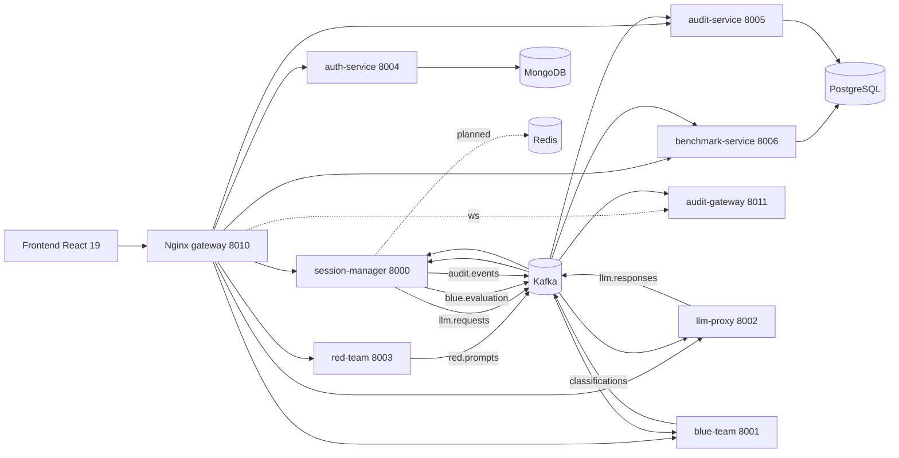
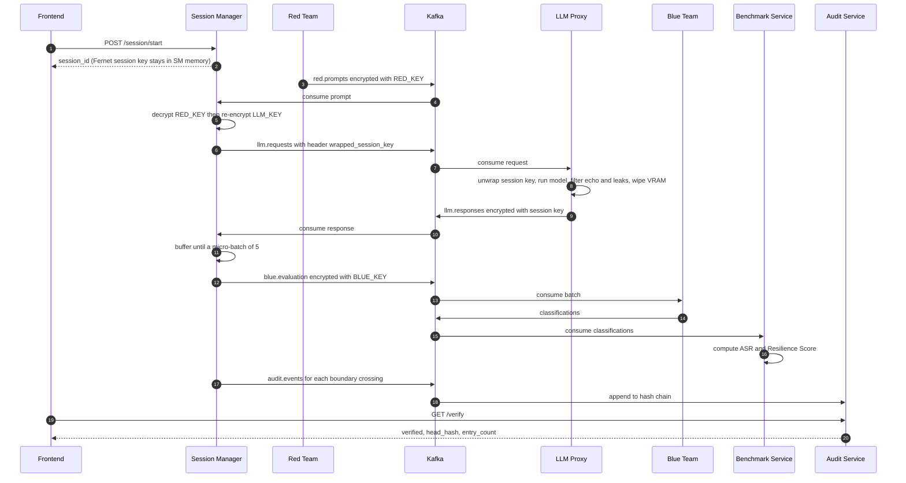

# Centinela (Bayora) — Architecture

> **Last reviewed:** 2026-11-22
> **Sources:** repo `README.md`, `WORKSTREAMS.md`, `PLAN.md`, and the Track 1 commits (`baa9f99` … `d727987`) including the current `Dockerfile` and `docker-compose.yml`.
> **Status legend:** **[implemented]** built and tested · **[partial]** built with known defects · **[planned]** not built yet · **(verify)** not confirmed against source — check the code before relying on it.
> **For IDE agents:** read `AGENTS.md` and `WORKSTREAMS.md` first. This file explains *what exists and how it fits together*; it does not authorize edits outside your track.

---

## 1. What Centinela is

Centinela (internal code name **Bayora**) is an automated adversarial AI-safety testing and compliance platform for LLMs. A **drill** works like this:

1. A **Red Team** service generates adversarial prompts (direct, DAN jailbreaks, roleplay, PAIR, GCG suffixes).
2. A **Session Manager** is the only mediator. It decrypts, re-encrypts and forwards prompts, so Red and Blue never talk directly.
3. A sandboxed **LLM Proxy** runs the target model, filters echoes and semantic leaks, and wipes GPU memory.
4. A **Blue Team** service classifies the (micro-batched) responses.
5. A **Benchmark Service** turns classifications into metrics (Attack Success Rate, Resilience Score).
6. An **Audit Service** records every cross-boundary event in an append-only SHA-256 hash chain that anyone can verify.
7. A **React 19 dashboard** streams the drill live and shows the result and compliance mapping.

The design goal is that testing teams cannot learn each other's secrets (prompt corpus, model internals) and that the final score cannot be quietly altered afterwards.

---

## 2. Components

| Service | Path | Port | Stack | Image target | Owner |
|---|---|---|---|---|---|
| Nginx gateway | `infra/nginx/centinela-gateway.conf` | **8010** | Nginx 1.25 | — | Track 1 (infra) |
| Auth service | `bayora/services/auth_service` | **8004** | FastAPI, Motor (MongoDB), PyJWT, passlib/bcrypt | `light` | Track 2 |
| Session Manager | `bayora/services/session_manager` | **8000** | FastAPI, aiokafka, cryptography | `light` | Track 1 |
| LLM Proxy | `bayora/services/llm_proxy` | **8002** | FastAPI, PyTorch, vLLM / Ollama / HF / Gemini, sentence-transformers | `ml` | Track 2 (`bus.py` and key handoff: Track 1) |
| Red Team | `bayora/services/red_team` | **8003** | FastAPI, LiteLLM engine (PAIR) | `light` (needs `litellm`, **verify**) | not assigned in `WORKSTREAMS.md` |
| Blue Team | `bayora/services/blue_team` | **8001** | FastAPI, PyTorch, Transformers, PEFT | `ml` | shared: Kafka handling Track 1, ML imports Track 2 |
| Benchmark Service | `bayora/services/benchmark_service` | **8006** | FastAPI, PostgreSQL | `light` | not assigned (auth work is in PLAN task 1.4) |
| Audit Service | `bayora/services/audit_service` | **8005** | FastAPI, psycopg2, aiokafka | `light` | Track 1 |
| Audit Gateway | `bayora/services/audit_gateway` | **8011** | WebSocket telemetry fan-out | `light` | not assigned |
| Frontend | `frontend/` | 5173 (dev) | React 19, TanStack Start, Vite 7, Tailwind v4 | — | Track 2 |

**Infrastructure services** (from `docker-compose.yml` and the README):

| Component | Purpose |
|---|---|
| Apache Kafka + Zookeeper | Event bus. Listeners: `INTERNAL://kafka:9092` (containers), `EXTERNAL://localhost:9094` (host). Has a healthcheck. |
| `kafka-init` | One-shot job that creates every topic (3 partitions, replication factor 1, `--if-not-exists`). Services wait for `service_completed_successfully`. |
| PostgreSQL 16 | `bayora_audit` (ledger) and `bayora_benchmark` (drills, leaderboard) |
| MongoDB | `bayora_auth` (users, encrypted API keys) |
| Redis | **[planned]** session persistence (PLAN task 3.1) |

### Gateway routes (Nginx, port 8010)

| Path | Upstream |
|---|---|
| `/api/auth/`, `/api/config/` | auth-service :8004 |
| `/api/session/` | session-manager :8000 |
| `/api/llm/` | llm-proxy :8002 |
| `/api/attack/` | red-team :8003 |
| `/api/evaluate/` | blue-team :8001 |
| `/api/drills/`, `/api/leaderboard` | benchmark-service :8006 |
| `/api/verify` | audit-service :8005 |
| `/ws/` | audit-gateway :8011 |

---

## 3. A drill, end to end

Notes:
- Prompts can also enter through `POST /session/infer` (the client sends a base64 Fernet-encrypted prompt); `consume_red_prompt` handles both paths.
- Release of responses to Blue is **micro-batched** (batch size 5) to blunt timing side channels, and delayed after session end.
- `POST /session/end` revokes the session key and clears buffers. A Falco violation event terminates the session automatically (`violations.py`).
- Telemetry shown in the UI comes over WebSocket from `audit-gateway` (`session.progress`, classification events — exact topics **verify**).

---

## 4. Cryptographic model

### 4.1 Keys

| Key | Type | Held by | Used for |
|---|---|---|---|
| `RED_KEY` | Fernet | red-team, session-manager | Red → SM prompt channel |
| `LLM_KEY` | Fernet | session-manager, llm-proxy | SM → proxy request channel |
| `SESSION_KEY` | Fernet, **per session, ephemeral** | generated by session-manager | Proxy encrypts responses; SM decrypts. Never sent in plaintext on Kafka |
| `BLUE_KEY` | Fernet | session-manager, blue-team | SM → Blue evaluation channel |
| LLM-proxy RSA pair | RSA-2048, OAEP / SHA-256 | public key: session-manager · private key: llm-proxy | Wraps `SESSION_KEY` for the proxy **[implemented, commit `f9a801f`]** |
| `JWT_SECRET` | HS256 secret | auth-service, other services that verify tokens | User identity |
| `MASTER_KEY` | Fernet | session-manager | Encrypt session keys at rest in Redis **[planned use; validated at startup]** |
| `SERVICE_SHARED_SECRET` | random string | session-manager, benchmark-service | Service-to-service auth **[planned use; validated at startup]** |
| `AUDIT_SALT` | random string | audit-service | HMAC of payloads **[planned use; validated at startup]** |
| `AUDIT_SIGNING_KEY_B64` | Ed25519 private key (raw, base64) | audit-service | Sign each entry hash **[planned use; validated at startup]** |

### 4.2 Session-key handoff (current design)

Before commit `3af0585` the session key travelled as a plaintext Kafka header, so anyone able to read `llm.requests` could decrypt that session's responses. Now:

1. Session Manager wraps the session key with the proxy's **public** key (RSA-OAEP, SHA-256, `label=None`).
2. The wrapped key is sent in the Kafka header `wrapped_session_key` (base64). The header `session_id` is the only other header. **No `session_key` header exists.**
3. LLM Proxy unwraps it with its **private** key and builds `Fernet(session_key)`. If the header is missing or the unwrap fails, the proxy logs an error. It must not skip silently.

Key formats: public key = base64 of DER `SubjectPublicKeyInfo`; private key = base64 of DER `PKCS8`.

### 4.3 Fail-closed startup

Every service validates its required secrets in the FastAPI **lifespan** and raises `RuntimeError` if any is missing. No service generates a fallback key. `docker-compose.yml` uses `${VAR:?VAR is required}` so Compose itself refuses to start without them.

---

## 5. Defense-in-depth layers

| # | Layer | Mechanism | Purpose |
|---|---|---|---|
| 1 | User-space kernel sandbox | gVisor `runsc` RuntimeClass | Contain model-code escapes |
| 2 | Kubernetes namespaces | `red-team`, `blue-team`, `llm-sandbox`, `session-manager` | Tenant boundaries |
| 3 | Network policy | Default-deny NetworkPolicy | Block east-west traffic between team namespaces |
| 4 | Service mesh | Istio mTLS, AuthorizationPolicy | Mutual TLS and service identity |
| 5 | Application crypto | Fernet channels plus RSA-wrapped session key | Payload confidentiality on Kafka |
| 6 | Runtime detection | Falco eBPF rules → `security.violations` | Auto-terminate a session on a breach |

Layers 1–4 and 6 exist as Kubernetes/Falco manifests; they are not exercised by Docker Compose.

### Threat model (summary)

| Threat | Mitigation | Status |
|---|---|---|
| Network side channels | Istio mTLS, default-deny policies | [implemented] in K8s manifests |
| KV-cache leakage | `use_cache=False`, `torch.cuda.empty_cache()` + `gc.collect()` | [implemented] |
| Timing side channels | Micro-batch release (size 5) | [implemented] |
| Prompt-corpus theft | RED_KEY encryption, Blue only sees released batches | [implemented] |
| Plaintext session key on Kafka | RSA-OAEP wrapping | [implemented] |
| Syscall escapes | gVisor plus Seccomp profiles | [implemented] in K8s manifests |
| Audit tampering | Hash chain plus `/verify` | [partial] — see section 7 |
| Shared-DRAM attacks | Dedicated node pools; TDX/SEV on roadmap | residual risk |

---

## 6. Kafka topics

| Topic | Producer → Consumer | Payload |
|---|---|---|
| `red.prompts` | red-team → session-manager | Fernet(`RED_KEY`) |
| `llm.requests` | session-manager → llm-proxy | Fernet(`LLM_KEY`); header `wrapped_session_key` |
| `llm.responses` | llm-proxy → session-manager | Fernet(`SESSION_KEY`) |
| `blue.evaluation` | session-manager → blue-team | micro-batched JSON, Fernet(`BLUE_KEY`) |
| `classifications` | blue-team → benchmark-service **(verify)** | classification results |
| `benchmark.reports` | benchmark-service → consumers **(verify)** | drill reports |
| `session.progress` | session-manager / benchmark → audit-gateway **(verify)** | progress events for the UI |
| `security.violations` | Falco bridge → session-manager **(verify)** | breach events that end a session |
| `audit.events` | all services → audit-service | audit event envelope |
| `audit.events.dlq` | audit-service → (manual replay) | raw message after 3 failed inserts **[implemented, commit `7254d8f`]** |

Rules for all topics: payloads are UTF-8 **JSON** (`json.dumps` / `json.loads`; never `str()` or `ast.literal_eval`). Headers hold only `session_id` and `wrapped_session_key`.

---

## 7. Audit ledger

**Schema (PostgreSQL `bayora_audit`, table `audit_entries`):** `event_type, source_namespace, session_id, payload_hash, timestamp_ns, prev_hash, entry_hash` with a **UNIQUE** constraint on `entry_hash`. The first `prev_hash` is `sha256(b"genesis")`. An existing database needs `ALTER TABLE audit_entries ADD CONSTRAINT audit_entries_entry_hash_key UNIQUE (entry_hash);` because `CREATE TABLE IF NOT EXISTS` will not add it.

**Append behavior [implemented, `7254d8f`]:**
- Insert runs inside `with conn:` (commit on success, rollback on error) and uses `ON CONFLICT (entry_hash) DO NOTHING`.
- `_head_hash` advances **only after the commit succeeds**. A failed insert never moves the head, so the chain cannot fork.
- On failure: up to 3 attempts with `asyncio.sleep` backoff (100, 200, 400 ms), and the DB connection is re-opened before each retry. After the last failure the raw message goes to `audit.events.dlq`, and only then is the Kafka offset committed.
- The consumer uses `enable_auto_commit=False`. If the dead-letter publish itself fails, the offset is **not** committed.
- With no database, an in-memory chain is used (this is what the tests exercise).

**Verification:** `GET /verify` on audit-service (via the gateway `/api/verify`) walks the chain and returns `{verified, head_hash, entry_count}`.

**Known weaknesses [partial]:**
- One **global** chain guarded by an in-process lock; this breaks with more than one worker. PLAN task 1.3 moves to a chain **per session**.
- Payload hash is a raw SHA-256. PLAN replaces it with `HMAC-SHA256(AUDIT_SALT, payload)`, because short prompts can be recovered with a dictionary.
- Entries are not signed yet. PLAN adds an Ed25519 signature per entry (`AUDIT_SIGNING_KEY_B64`).
- Redelivered Kafka messages produce a new timestamp and so a new `entry_hash`, so `ON CONFLICT` does not de-duplicate redeliveries. A stable event id is needed for that.
- Session Manager still has a fake `/audit/verify/{session_id}` stub that should be deleted so verification goes only through audit-service.

---

## 8. Data stores

| Store | Database | Contents |
|---|---|---|
| PostgreSQL 16 | `bayora_audit` | `audit_entries` (the ledger) |
| PostgreSQL 16 | `bayora_benchmark` | drills, results, leaderboard |
| MongoDB | `bayora_auth` | users, hashed passwords, encrypted LLM API keys |
| In-memory | session-manager | `session_keys`, `session_raw_keys`, unreleased response buffers — **lost on restart** |
| Redis | — | **[planned]** replaces the in-memory session state, with TTL and keys encrypted by `MASTER_KEY` |

---

## 9. Frontend

React 19, TanStack Start (SSR + SPA), TanStack Router and Query v5, Tailwind v4, Shadcn UI, GSAP, Sonner.

| Route | Purpose |
|---|---|
| `/` | Landing page |
| `/login`, `/register` | Authentication |
| `/config` | Choose attack vectors, launch a drill |
| `/audit` | Live telemetry dashboard (WebSocket) |
| `/results` | Resilience score and compliance certificate |
| `/profile` | User profile and audit history |

`frontend/src/lib/api.ts` is the single fetch/WebSocket client. It should target the gateway (`:8010`); today it still calls service ports directly **(see gaps)**.

---

## 10. Run modes

| Mode | Command | What runs | Needs |
|---|---|---|---|
| **A. Demo** | `python demo_server.py` + `cd frontend && npm run dev` | Mock Auth 8004, Session 8000, Benchmark 8006 and WebSocket 8011 in one process, in-memory data | Python only |
| **B. Local supervisor** | `python run_backend.py` | All 8 services as subprocesses with `MOCK_LLM=1` | Python — **see gaps** |
| **C. Docker Compose** | create `.env`, then `docker compose up --build` | Kafka, Zookeeper, Postgres, Mongo, Nginx and all services | Docker; ML services need a CUDA Linux host |
| **D. Kubernetes** | `make deploy` | EKS (Terraform), Strimzi Kafka, namespaces, netpols, gVisor, Istio, apps | Cloud account |

**Docker images.** One `Dockerfile` with two targets:
- `light` = `python:3.11-slim` + `requirements.txt` only (FastAPI, uvicorn, pydantic, cryptography, aiokafka, psycopg2-binary, requests, pyyaml, python-dotenv, motor, pyjwt, passlib, bcrypt, email-validator). Used by session-manager, audit-service, audit-gateway, auth-service, benchmark-service, red-team.
- `ml` = `light` + `requirements-llm.txt` (torch, transformers, peft, vLLM, …). Used by llm-proxy and blue-team.

vLLM does not run on Apple Silicon, so on a Mac start only the light services plus Kafka: `docker compose up --build kafka kafka-init session-manager audit-service`.

---

## 11. Configuration reference

Variables validated at startup (service refuses to boot if missing):

| Service | Required variables |
|---|---|
| session-manager | `RED_KEY`, `BLUE_KEY`, `LLM_KEY`, `MASTER_KEY`, `JWT_SECRET`, `SERVICE_SHARED_SECRET`, `LLM_PROXY_PUBLIC_KEY_B64` |
| llm-proxy | `LLM_KEY`, `JWT_SECRET`, `LLM_PROXY_PRIVATE_KEY_B64` |
| audit-service | `AUDIT_SALT`, `AUDIT_SIGNING_KEY_B64`, `JWT_SECRET` |
| red-team | `RED_KEY`, `JWT_SECRET` |
| blue-team | `BLUE_KEY`, `JWT_SECRET` |
| auth-service | `JWT_SECRET`, `MONGO_URI` |
| audit-gateway | `JWT_SECRET` |

Other: `KAFKA_BOOTSTRAP_SERVERS` (`kafka:9092` in containers, `localhost:9094` from the host), `GOOGLE_API_KEY` (optional, Gemini), `MOCK_LLM=1` (supervisor mode).

Rules: `.env`, `.env.test`, `.venv/` and `.DS_Store` are git-ignored; `.env.example` holds placeholders only; never print or commit key values. A key that has appeared in a chat or log is burned, so regenerate it.

---

## 12. Metrics and compliance

- **Attack Success Rate (ASR)** = harmful responses ÷ total attack/response pairs. Lower is better. The code and UI still call it `bypass_rate` (PLAN task 2.2 renames it).
- **Resilience Score** = `(1 − ASR) × 100`. Higher is better.
- Over-refusal on benign look-alike prompts is measured with XSTest **[planned]**.

| Framework | Evidence Centinela provides |
|---|---|
| EU AI Act Art. 15 (also 9, 14) | Adversarial robustness scores, human kill-switch via live telemetry |
| HIPAA 45 CFR 164.312(b) | Tamper-evident audit controls |
| SOX / SOC 2 | Key isolation between tenants |
| NIST AI RMF 1.0 | Quantitative resilience scoring |
| OWASP LLM01 / LLM06, MITRE ATLAS AML.T0054 | Category mapping **[planned]** (PLAN task 4.4) |

---

## 13. Status

### Done (Track 1, committed locally; 13 tests pass with `make test-track1`)

| Item | Commit |
|---|---|
| Kafka INTERNAL/EXTERNAL listeners, healthcheck, topic-creation job | `baa9f99` |
| JSON serialization (no `ast.literal_eval`) | Track 1 commit before `3af0585` |
| `session_key` removed from headers; fail-closed startup validation | `3af0585` |
| Transactional audit append, retry, dead-letter topic, manual offset commit | `7254d8f` |
| RSA-OAEP session-key wrapping; Compose env wiring with `${VAR:?}` | `f9a801f` |
| `make test` / `make test-track1` fixed | `b7843c1`, `d727987` |
| Slim multi-stage Dockerfile (`light` / `ml`) | in the working tree (verify it is committed) |

### Open

| Area | Gap | Owner |
|---|---|---|
| Auth | `/session/start`, `/infer`, `/end` use a no-op `verify_token()` returning `anonymous`; no ownership check (PLAN 1.4). `/session/start` also returns `session_key` in its response (**verify intent**) | Track 1 |
| Audit | Per-session chains, HMAC payload hashes, Ed25519 signatures; delete the verify stub in session-manager | Track 1 |
| Persistence | Session state in memory only; Redis planned | Track 1 |
| Run modes | `run_backend.py` generates keys at runtime and predates the new required variables. `bayora/infra/scripts/generate-keys.py` (used by `make keys` and Mode C) predates them too. Both need updating or Modes B and C will fail startup validation | Track 1 / unassigned |
| Images | `red-team` is on `light` but its engine imports `litellm` | Track 1 |
| K8s | `apps.yaml` lacks auth-service, audit-gateway, MongoDB and the gateway (PLAN 3.3); manifests still deploy the older stack | Track 1 |
| CI | No `.github/workflows/ci.yml` (lint, ruff, bandit, pytest, Trivy) | Track 1 |
| ML | `toxic-bert` measures toxicity, not harmful compliance; no refusal heuristics; adapter can fall back to a random head; PAIR runs 3 fixed iterations with no judge score | Track 2 |
| Datasets | Loader returns 3 hard-coded sample prompts instead of AdvBench 520, JailbreakBench, HarmBench, XSTest | Track 2 |
| Frontend | `audit.tsx:85` `useRef()` TS2554 breaks `tsc`/build; `api.ts` bypasses the gateway; profile and PDF export are mocked; metric still labelled bypass rate | Track 2 |
| Tests | `test_llm_proxy.py:66` `LLM_KEY.encode()` bug; Track 2 tests need `torch` and `litellm` in the environment | Track 2 |
| Enterprise | Signed attestation bundle, commit-reveal for Red Team, canary/honeytoken leak test | later |

---

## 14. Where to look (map for agents)

| If you need to change… | Look at | Track |
|---|---|---|
| Kafka topics, listeners, compose env | `docker-compose.yml` | 1 |
| Image build, targets | `Dockerfile` | 1 |
| Session lifecycle, key handling | `session_manager/main.py`, `bus.py` | 1 |
| Session termination on Falco breach | `session_manager/violations.py` | 1 |
| Ledger append / verify / DLQ | `audit_service/main.py` | 1 |
| Proxy request handling, key unwrap | `llm_proxy/main.py`, `bus.py` | 1 for key handoff, otherwise 2 |
| Inference sandbox, leak filter | `llm_proxy/inference.py` | 2 |
| Blue Team Kafka handling | `blue_team/main.py` | 1 |
| Classifier | `bayora/ml/classifiers/defense.py` | 2 |
| Attack generation / PAIR | `bayora/ml/attack_generators/engine.py` | 2 |
| Datasets | `bayora/datasets/loaders/common.py`, `manifest.json` | 2 |
| UI | `frontend/src/routes/*`, `src/lib/api.ts` | 2 |
| Kubernetes, Istio, netpols, Terraform | `bayora/infra/**` | 1 |
| Falco rules | `bayora/monitoring/falco_rules/bayora_rules.yaml` | 1 |
| Tests | `tests/integration/*` | per file |

**Verify your track's work with:**
- Track 1: `make test-track1`
- Track 2: `cd frontend && npx tsc --noEmit && npm run build`, then `python3 -m pytest tests/integration/test_llm_proxy.py tests/integration/test_pipelines.py -v` in an environment that has `torch` and `litellm`.
